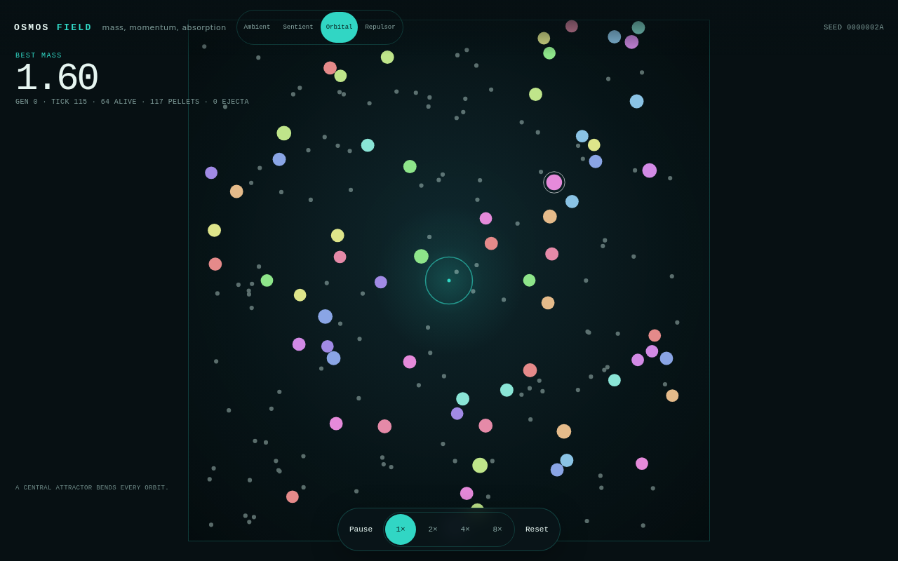
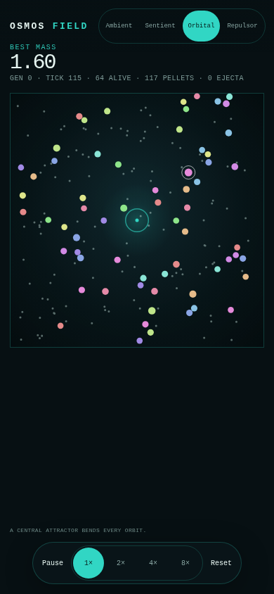
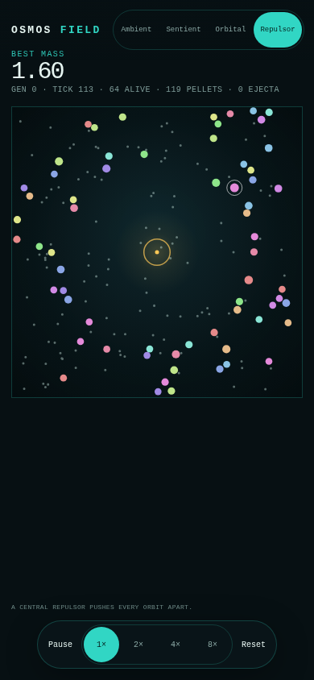

# APK 机制分析与场力引入

- 日期：2026-10-23
- 分支：`feature/apk-mechanics`
- APK：`/home/ubuntu/osmos-v2.10.0-full.apk`
- SHA-256：`951b2116e997a3810e415623467bf8f4eb4be0facc9518b07df30c006cf046bd`
- APK 未提交。解包目录在 `/tmp`，仓库只保留结论、截图和原始日志。

## 1. 结论

APK 是 Marmalade C++ 原生版本，不是 Unity。游戏逻辑在 `lib/arm64-v8a/libosmos.so`，文件约 2.9 MB，已剥离但是保留了大量可读 C++ 符号。资源里有 `.loc` 文本、`.tga` 贴图、`.ogg` 音乐和 Marmalade 配置。

本次只引入一个机制，即中心径向场力。正强度吸引，负强度排斥。新增 `Orbital` 和 `Repulsor` 两个场景。

本次不引入原版关卡、贴图、音乐、字体、关卡文本、手动触屏操作、广告和内购。没有复制反编译代码。所有实现是 Rust 中的新代码。

## 2. APK 证据

- 774 个文件，解压后 51.6 MB。`AndroidManifest.xml` 约 12.8 KB，`classes.dex` 约 2.1 MB。
- `lib/arm64-v8a/libosmos.so` 是 ELF64 AArch64，Marmalade 运行时，符号未全部删除。
- 可读符号包括 `CBlobiverse::ComputeGravity`、`ComputeOrbitEllipse`、`SetupOrbit`、`SetupAttractorLevelBlob`、`FireMass`、`Explode`、`Mitosis`、`TickSpawners`。
- AI 符号包括 `CBlobBrain::LookForThreats`、`Hunt`、`ComputeMassFire`、`ComputeScoreFromMassAndTime`，以及 `Zen`、`Scared`、`Killer`、`Ugly` 四种 personality。
- 关卡常量字符串包括 `GMP1_InitVel`、`GMP2_Repulsor`、`GMP3_Gravity`、`GMP5_PercentAnti`、`GMP5_SizePower`、`GMP6_MassPower`、`GMP5_DeathWalls`、`GMP1_InnerWallRadius`、`GMP10_MaxAttractorSize`。
- 模式名包括 Ambient、Sentient、Solar、Repulsor、Antimatter、Impasse、Epicycles、Warped Chaos、The Chase、Floating。
- 文本证据包括 `Tip_LetGravityDoTheWork`、`Tip_WaitingForOrbitalCollisions`、`Tip_Impasse2`、`Tip_Antimatter` 和 `LevelGoal_AbsorbTheAttractor`。

这些证据说明原版的核心不是单一吞噬，而是质量、动量、场力和 AI 决策的组合。

## 3. 取舍

| 机制 | 结果 | 原因 |
| --- | --- | --- |
| 质量、喷射、再吸收 | 已存在 | 当前项目已实现 |
| 中心吸引和排斥 | 引入 | 当前缺失，视觉和 AI 行为都明显 |
| 椭圆轨道、初始切向速度 | 引入 | 不设置切向速度会直接落入中心 |
| 多井、太阳系、死亡墙 | 暂缓 | 需要多体和关卡数据，先验证单井 |
| Sentient personality | 暂缓 | 需要新 AI 设计，避免一次改动过大 |
| Antimatter 湮灭 | 暂缓 | 质量账本和碰撞语义风险高 |
| Mitosis、Explode、Spawner | 暂缓 | 与当前固定人口和适应度冲突 |
| 原版关卡、美术、音乐、文本 | 不引入 | IP 和范围边界 |
| 手动触屏、广告、内购 | 不引入 | 当前产品是零玩家观察 |

## 4. 实现

新增 `osmos-sim/src/gravity.rs` 的 `GravityWell`。

```text
acceleration = strength / (distance² + softening²)
```

结果按 `max_accel` 截断。正值指向中心，负值远离中心。场力作用于质体和喷出物，不改变质量。

参数。

| 参数 | 值 |
| --- | --- |
| 强度 | `+0.002` 或 `-0.002` |
| 软化半径 | `0.04` |
| 最大加速度 | `0.12` |
| 井半径，仅绘制 | `0.045` |
| 初始切向速度 | 圆轨道速度的 `1.0` 倍 |

场景。

- `Orbital`：64 个 AI，180 个颗粒，中心吸引。
- `Repulsor`：64 个 AI，180 个颗粒，中心排斥。
- `Ambient` 和 `Sentient` 保持场强 0。

Web 快照新增 `wellState`，每 4 个浮点数是一口井，依次为 `x`、`y`、半径和符号。Canvas 用青色画吸引，用琥珀色画排斥。







## 5. 没有直接加入场力传感器

当前网络是 55-8-2，基因组 466 个值。直接加入场力输入会改变输入数和基因组布局，使现有学习门禁失效。

这次先利用固定场的特点。场的位置是常量，质体的位置和速度已经能表达它。`Ambient` 的随机数顺序和物理路径保持不变，1,000 步哈希仍是 `99b4716d6a4f0026`。

直接场力输入留到下一轮。若加入 2 个输入，需要重新训练，并重新跑 3 个种子的 60 代门禁。

## 6. 验证

- Rust 测试 39 个通过。`osmos-core` 5 个，`osmos-evo` 9 个，`osmos-sim` 25 个。
- `cargo fmt`、Clippy、TypeScript 和 Oxlint 通过。
- 1,000 步 Ambient 哈希不变，说明旧场景没有漂移。
- 60 秒浏览器测试 8 个场景组合，帧率 58.85 到 59.98 fps，页面错误 0。
- 8× 桌面 `step` p95 7.7 ms，手机 7.6 ms。
- Orbital 手机 4× 为 59.90 fps，`step` p95 4.7 ms。
- Repulsor 手机 4× 为 59.98 fps，`step` p95 3.7 ms。
- 500 个实体，64 个 AI 加 436 个颗粒，Orbital 2,400 步 0.69 秒。
- wasm 111.09 KB，gzip 46.74 KB。JavaScript 28.50 KB，gzip 11.06 KB。CSS 6.13 KB，gzip 1.76 KB。
- 交互测试确认 Pause、Reset、Orbital、Repulsor 按钮和 URL 同步可用。

证据在 `docs/apk-mechanics/evidence/`。截图在 `docs/apk-mechanics/`。

## 7. 限制

- Orbital 和 Repulsor 没有进入 60 代学习门禁。当前只验证物理、页面和性能。
- 场力传感器没有加入。AI 依靠位置和速度间接感知固定场。
- 只有一个中心井。多井、椭圆轨道和太阳系还未实现。
- Sentient personality、Antimatter、Mitosis、Spawner 和死亡墙仍是候选。
- 生产根站仍是旧版。新构建只在 `/next/` 预览。

## 8. 下一轮候选

1. 给 Orbital 加入 2 个场力输入，重新训练并跑 3 个种子的 60 代门禁。
2. 把 `CBlobBrain` 的 Scared、Killer 行为压缩成可测试的脚本 AI，先服务 Sentient。
3. 用多井和负场构造 Epicycles 和 Repulsor 关卡。
4. 最后再评估 Antimatter，因为它需要独立的质量湮灭账本。
