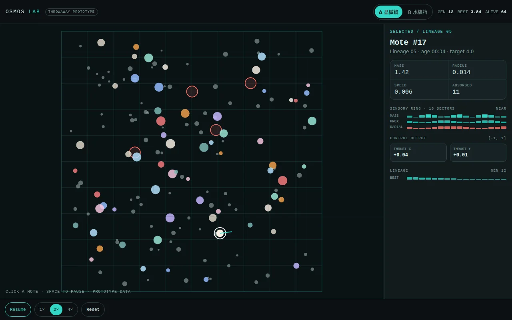
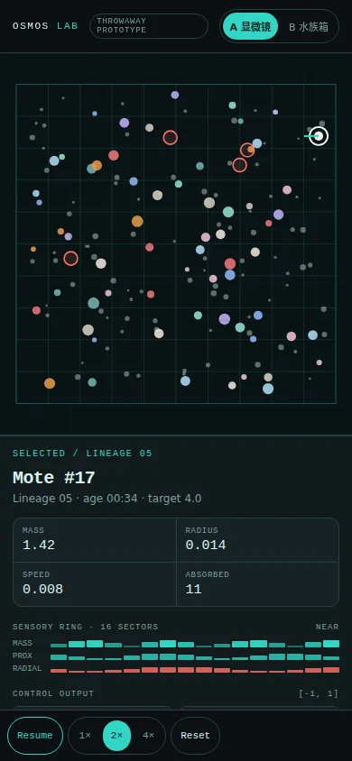
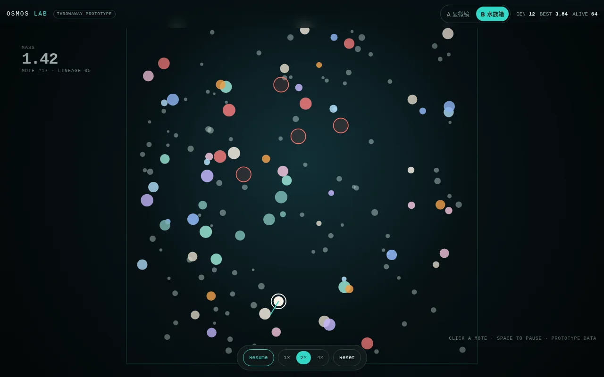
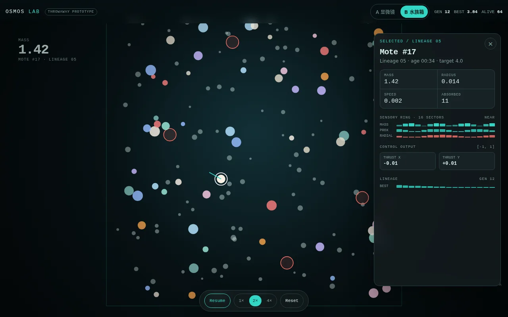
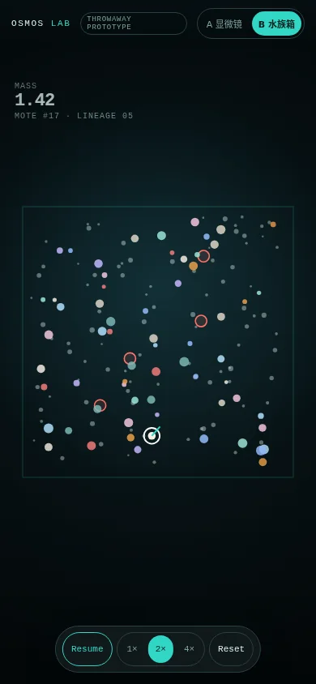
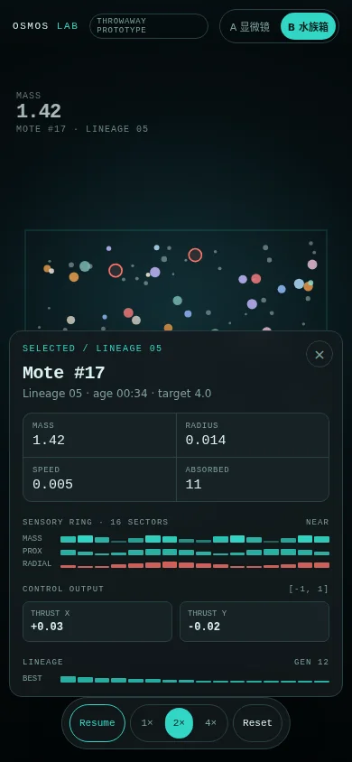

# Phase 0：原型与基线

- 日期：2026-10-22
- 状态：完成，等待视觉方向确认
- 分支：`rewrite/osmos-v2`
- 计划提交：`371b572`
- Phase 0 证据：本分支最新提交
- 范围：视觉方向、性能基线、CI 骨架
- 不包含：正式实现代码

## 1. 结论

视觉方向选择 B「水族箱」作为外壳，吸收 A「显微镜」的检查面板密度。

桌面端使用全幅画布，检查面板在选中质体时从右侧出现。手机端使用全幅画布，检查面板从底部出现。暂停或检查时显示 A 的网格和感知覆盖层，运行中保持干净。

人口默认保持 64 个 AI 质体，300 个实体作为 1× 目标，500 个实体作为压力测试。目标设备定为 2022 年中端 Android，6 GB 内存，60 Hz 屏幕，Pixel 6a 级别。Phase 5 用真机或云真机验证。

Worker 暂不进入 v1。Phase 2 记录 8× 下每帧 16 步的 `step` 和 `snapshot` p95，超过 8 ms 时再加。

## 2. 视觉原型

### 2.1 方法

原型位于 `/tmp/osmos-phase0/prototypes/index.html`，是丢弃型 HTML、CSS 和 Canvas 2D。没有使用生产框架，没有写入仓库。

页面顶部有一个切换器，A 和 B 共用同一组模拟数据。数据只用于视觉判断，不含真实物理、感知或演化。

原型支持切换方向、暂停、1×、2×、4×、点击选中质体、打开和关闭检查面板。交互检查通过，没有页面错误。

截图为暂停状态。原型服务保留在 `http://127.0.0.1:8098`，评审结束后停止。

### 2.2 A 显微镜



A 使用固定双栏。画布带网格，右侧检查面板常驻。画布约为 648 px，检查面板 320 px。

优点。

- 数据和画布同时可见，不需要打开面板。
- 传感器、网络输出和质量放在同一屏，适合比较和调试。
- 手机端画布在上，检查面板在下，空间利用比 B 的空白区更好。

问题。

- 画布比 B 小，观察沉浸感弱。
- 常驻网格在长时间观看时干扰运动。
- 手机端检查面板限制为 36 dvh，控制输出被裁切，需要滚动。



### 2.3 B 水族箱



B 使用全幅画布。HUD 和控件悬浮，检查面板在选中后出现。画布约为 744 px，比 A 大 15%。

优点。

- 画布是主角，运动更容易看清。
- HUD 和控件退到边缘，首屏更安静。
- 检查面板按需出现，观察和检查不互相打断。

问题。

- 桌面检查面板固定高度，底部有大片空白。
- 手机顶部的原型徽章换行，挤占空间。
- 手机隐藏了世代、最佳和存活数，运行状态不可见。
- 手机画布居中，上下留白较多。



### 2.4 B 的手机检查





手机检查面板从底部出现，保留画布上半部分。面板内容完整，关闭按钮在右上角。暂停后检查不会继续变化。

需要修正三点。

- 隐藏原型徽章，给切换器和运行状态留出空间。
- 在控件上方增加紧凑的 `GEN / BEST / ALIVE` 运行条。
- 检查面板高度改为内容自适应，最大不超过 52 dvh。

### 2.5 视觉决策

选择 B 作为基础，原因是画布更大，首屏更安静，检查按需出现。A 的检查面板信息结构更好，直接复用。

最终布局采用以下组合。

- 全幅画布，深色流体背景，不在运行时显示网格。
- 桌面右侧检查面板，宽度 320 px，高度自适应。
- 手机底部检查面板，最大 52 dvh，关闭按钮固定在右上角。
- 手机运行条显示世代、最佳质量和存活数。
- 暂停或检查时显示网格、感知扇区和推进箭头。
- 顶部只保留品牌、场景和运行状态，不放原型徽章。

## 3. 性能基线

### 3.1 方法

`perf` 事件被 `perf_event_paranoid=4` 阻止，无法采样。改用两个临时基准，源和原始输出保存在 `docs/phase-0/evidence/`。

`quiet` 基准只循环调用 `Simulator::step`，结束时输出步数、耗时、人口和世代。它测的是完整一步，不含每步格式化输出。

`phases` 基准在每一步分别计时 `sensor`、`network`、`collision`、`movement` 和 `epoch` 五个公开系统调用。它测的是相对占比，有少量计时开销。

环境为 2 核、3.8 GB 内存、Ubuntu。原生 release 构建，`lto = true`，`codegen-units = 1`，`strip = true`。阶段基准使用 `taskset -c 0` 绑定单核，减少浏览器进程的干扰。跑前负载约 0.86。每侧运行 5 次，同一侧连续运行。没有新实现，因此没有新旧对比。

### 3.2 结果

300 个实体的静默吞吐。

| 运行 | 步/秒 |
| --- | --- |
| 1 | 1,722.5 |
| 2 | 1,761.6 |
| 3 | 1,794.5 |
| 4 | 1,850.8 |
| 5 | 1,898.6 |

中位数为 1,794.5 步/秒，范围为 1,722.5 到 1,898.6。5 次运行都完成 10,000 步，最终人口 57 到 270，世代 11 到 12。

单独一次 `/usr/bin/time -v` 运行显示 99% CPU 和 3,132 KB 最大常驻内存。原始输出见 `docs/phase-0/evidence/quiet-bench/quiet-time-v.txt`。限制因素是单核计算，不是磁盘、网络或内存。

300 个实体的阶段占比。

| 运行 | 步/秒 | 传感器 | 碰撞 | 网络 | 最终人口 | 世代 |
| --- | --- | --- | --- | --- | --- | --- |
| 1 | 1,659.8 | 84.6% | 13.0% | 1.7% | 79 | 3 |
| 2 | 1,681.2 | 84.5% | 13.2% | 1.7% | 118 | 3 |
| 3 | 1,471.9 | 83.7% | 13.8% | 1.9% | 75 | 3 |
| 4 | 1,634.6 | 84.4% | 13.2% | 1.7% | 57 | 3 |
| 5 | 1,588.8 | 84.6% | 13.0% | 1.8% | 98 | 3 |

中位数为 1,634.6 步/秒，范围为 1,471.9 到 1,681.2。传感器占 83.7% 到 84.6%，碰撞占 13.0% 到 13.8%，网络占 1.7% 到 1.9%。原始输出见 `docs/phase-0/evidence/phase-bench/phases-300-5runs.txt`。

传感器是主要成本，碰撞次之。旧网络只有 4-8-1，所以网络占比低。新网络为 55-24-2，网络成本会上升，但传感器和碰撞仍是主路径。另一批低负载运行显示传感器约 81%、碰撞约 17%，排序不变，具体比例随负载和人口变化。

500 个实体的阶段吞吐。

| 运行 | 步/秒 | 传感器 | 碰撞 | 网络 | 最终人口 | 世代 |
| --- | --- | --- | --- | --- | --- | --- |
| 1 | 784.3 | 84.2% | 14.0% | 1.4% | 94 | 2 |
| 2 | 786.8 | 84.7% | 13.4% | 1.3% | 93 | 2 |
| 3 | 831.4 | 85.1% | 13.2% | 1.2% | 102 | 2 |
| 4 | 769.6 | 84.2% | 13.8% | 1.5% | 62 | 2 |
| 5 | 769.8 | 84.6% | 13.6% | 1.4% | 107 | 2 |

中位数为 784.3 步/秒，范围为 769.6 到 831.4。传感器占 84.2% 到 85.1%，碰撞占 13.2% 到 14.0%，网络占 1.2% 到 1.5%。原始输出见 `docs/phase-0/evidence/phase-bench/phases-500-5runs.txt`。

500 个实体的中位数是 784.3 步/秒，300 个实体的中位数是 1,634.6 步/秒，慢 2.08 倍。纯线性是 1.67 倍，纯平方是 2.78 倍。结果落在两者之间，说明成本随实体数上升，但不能把 2.08 倍当成 O(n²) 的干净证明。人口变化和世代重置会改变每步成本。

这不是新旧实现的加速比，只是旧实现的规模测试。

### 3.3 和计划基线的关系

计划中的 1,626 步/秒来自 `osmos-cli`，含每步 `println!` 和标准输出。静默模式中位数为 1,794.5，CLI 低约 10%。这 10% 是格式化和标准输出的合计成本，没有单独拆分。

结论不变。传感器是最大热点，碰撞次之，网络不是当前瓶颈。Phase 1 必须先做空间网格和传感器查询，不应先做视觉特效或更多场景。

500 个实体的 784.3 步/秒低于计划的 2,400 步/秒。这个差距需要网格、复用缓冲和更少的每步分配来弥补。Phase 2 用 64 个 AI 质体和 55-24-2 网络重新测量，不能用旧网络数字推算新网络。

### 3.4 基准限制

- 测量对象是旧实现，不是重写后的实现。
- 环境是 2 核 VPS，不是目标手机。
- 阶段计时有计时器开销，只用于占比。
- 每侧连续运行，没有交错新旧两侧，因为没有新旧两侧。
- `perf` 被系统限制，无法给出函数级采样。
- 500 个实体只跑 2,000 步，300 个实体跑 3,000 到 10,000 步，规模测试不用于计算加速比。

这些限制写在报告里，避免把旧基线当成新实现的性能承诺。

## 4. CI 与验证

新增 `.github/workflows/ci.yml`。工作流在 `master` 和 `rewrite/**` 分支运行，执行以下步骤。

- `cargo test --workspace`
- `cargo clippy --workspace --all-targets -- -D warnings`
- 安装 `wasm-pack`
- `npm ci`
- `npm run build:wasm`
- `npm run check`
- `npm run build`

本地验证结果。

- `cargo test --workspace` 通过。
- `cargo clippy --workspace --all-targets -- -D warnings` 通过。
- `npm run check` 通过。
- `npm run build:wasm` 通过。
- `npm run build` 通过。
- 原型交互检查通过，页面错误为 0。

`cargo fmt --check` 当前不通过。旧代码没有被 rustfmt 统一，Phase 0 不格式化即将删除的旧代码。格式化门禁在 Phase 1 新 crate 落地时加入 CI，避免为旧代码制造大 diff。

工作流尚未在 GitHub 上运行，因为分支没有推送。本地命令是当前证据。

决策日志 `.audit/phase-0.tsv` 是本地工作文件，不提交。关键决策和证据已经写入本文件。

## 5. 决策记录

| 决策 | 选择 | 理由 |
| --- | --- | --- |
| 视觉外壳 | B 水族箱 | 画布更大，首屏更安静，检查按需出现 |
| 检查面板 | A 的信息结构 | 传感器、网络输出和成本在同一面板 |
| 人口 | 64 个 AI 质体 | 演化多样性和性能的起点 |
| 实体预算 | 1× 300，压力 500 | 与计划和基线一致 |
| 目标设备 | Pixel 6a 级中端 Android | 2022 年中端性能，60 Hz，6 GB 内存 |
| Worker | v1 暂不使用 | Phase 2 用 p95 决定 |
| 网格 | Phase 1 必做 | 传感器占 81%，碰撞占 17% |
| CI | 测试、静态检查、wasm 和 web 构建 | Phase 1 前建立可重复检查 |
| 格式化 | Phase 1 再加门禁 | 旧代码即将删除，不在 Phase 0 制造格式 diff |

## 6. 风险

| 风险 | 影响 | 缓解 |
| --- | --- | --- |
| 手机运行状态缺失 | 用户看不到世代进展 | 控件上方增加紧凑运行条 |
| 检查面板过高 | 遮挡画布 | 高度自适应，最大 52 dvh |
| 传感器成本过高 | 300 实体达不到 60 fps | 空间网格、扇区聚合、复用缓冲 |
| 目标设备未实测 | 预算可能偏乐观 | Phase 5 真机或云真机验证 |
| 旧基线被误读 | 用旧数字承诺新性能 | 报告明确标注旧实现、旧网络和 VPS |
| 格式化门禁延后 | 风格漂移 | Phase 1 新 crate 落地时立即加入 |

## 7. 进入 Phase 1 的条件

- 视觉方向确认，B 作为外壳，A 的检查面板结构复用。
- 数据契约确认，包括 `MoteState`、`moteRole`、快照位和基因顺序。
- Phase 1 的 PR 边界确认，先做世界、质量、碰撞、网格、快照和渲染，不做控制网络和演化。
- CI 在本地通过，工作流文件已提交。
- 进入 Phase 1 前停止原型服务；评审期间保留在 `http://127.0.0.1:8098`。

Phase 1 建议拆成 3 个 PR。

| PR | 范围 | 验收 |
| --- | --- | --- |
| P1 | `osmos-core` 和 `osmos-sim` 骨架，质量、边界、颗粒、吞噬、2 子步碰撞、空间网格、快照 | 质量守恒、穿透、确定性、300 实体 60 fps 的空载检查 |
| P2 | `osmos-evo` 最小 `Engine`，`osmos-wasm` 扁平 ABI，无演化 | wasm 加载、快照长度、1,000 步确定性检查 |
| P3 | `osmos-web` 全幅渲染、暂停、1×、2×、4×、8×、重置、手机布局 | 手机和桌面流程、无 console 错误、截图 |

P1 阻塞 P2，P2 阻塞 P3。P1 先由一个人完成核心类型和 ABI 形状，P2 和 P3 不在同一时间改快照布局。

## 附录 A. 复现命令

静默基准。

```bash
cd docs/phase-0/evidence/quiet-bench
cargo build --release
for i in 1 2 3 4 5; do taskset -c 0 ./target/release/osmos-quiet-bench 10000; done
```

阶段基准。

```bash
cd docs/phase-0/evidence/phase-bench
cargo build --release
for i in 1 2 3 4 5; do taskset -c 0 ./target/release/osmos-phase-bench 3000 300; done
for i in 1 2 3 4 5; do taskset -c 0 ./target/release/osmos-phase-bench 2000 500; done
```

原型和截图。

```bash
cd /tmp/osmos-phase0/prototypes
python3 -m http.server 8098 --bind 127.0.0.1
node capture.mjs
node check.mjs
```

CI 本地检查。

```bash
cargo test --workspace
cargo clippy --workspace --all-targets -- -D warnings
cd osmos-web
npm run check
npm run build:wasm
npm run build
```

## 附录 B. 原型说明

原型只用于选择布局和密度。它不验证物理、感知、演化或真实性能。正式实现不复用原型的 CSS、JavaScript 或数据模型。

截图文件在 `docs/phase-0/`，格式为 WebP。原型文件在 `/tmp`，不进入仓库。评审结束后删除。
