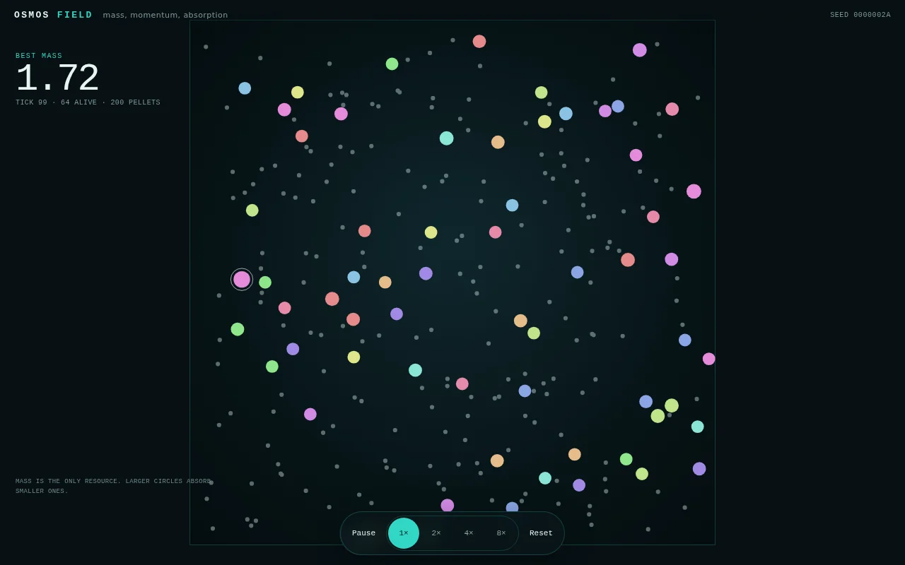
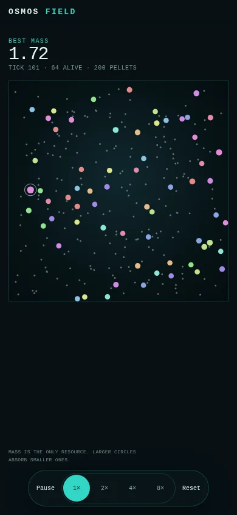

# Phase 1：质量世界

- 日期：2026-10-22
- 状态：完成
- 分支：`rewrite/osmos-v2`
- 提交：`be479d0`、`60c8e45`、`cf945fa`、`e6787c1`
- 范围：核心世界、扁平快照、最小引擎、wasm ABI、全幅渲染和控制
- 不包含：感知、控制网络、喷射推进、遗传算法、猎手、场景和检查面板

## 1. 结果

Phase 1 把旧的四象限网络模拟器替换成质量世界。世界有 64 个质体和 236 个颗粒，一共 300 个实体。质体随机漂移，吞并颗粒或更小的质体，质量相等或接近时弹开。

桌面和手机视口均达到 60 fps。1× 和 8× 都稳定。暂停、重置、速度切换和减少动态通过浏览器检查。

旧代码已删除。仓库现在有 4 个 Rust crate，`osmos-web` 是单独的 Web 包。

## 2. 画面



桌面使用全幅画布。最佳质量、刻度和存活数在左上角。控件在底部中央。最大质体有白色细环。



手机使用同一结构。画布在 HUD 下方，宽度等于视口减 28 px。控件保持 44 px 触控高度。

截图参数为 `seed=42`、1×、运行约 1.2 秒。截图时 64 个质体存活，200 个颗粒剩余。

## 3. 实现

### 3.1 Crate 边界

| Crate | 职责 |
| --- | --- |
| `osmos-core` | `MoteId`、`PelletId`、`LineageId`、`Mass`、`Vec2` |
| `osmos-sim` | 世界、质体、颗粒、碰撞、空间网格、快照 |
| `osmos-evo` | 最小 `Engine`，驱动世界和重置，不含演化 |
| `osmos-wasm` | `Engine` 包装、扁平数组快照 |
| `osmos-web` | SolidJS、Canvas 2D、固定步长循环、控件 |

旧 `osmos-ga`、`osmos-nn` 和 `osmos-cli` 已删除。遗传算法在 Phase 2 以 `osmos-evo` 模块回归。

### 3.2 数据形状

`Mote` 保存 ID、谱系、角色、质量、位置、速度、状态和吸收计数。`Pellet` 保存 ID、质量、位置和存活标记。

快照是扁平数组。

- `moteIds` 为 `Uint32Array`，每个质体一个 ID。
- `moteState` 为 `Float32Array`，步长 7，字段为 `x`、`y`、`vx`、`vy`、`mass`、`radius`、`hue`。
- `moteRole` 为 `Uint8Array`，0 表示 AI，1 表示猎手，2 表示猎物。
- `moteFlags` 为 `Uint8Array`，第 0 位是存活，第 1 位是达到目标质量。
- `pelletState` 为 `Float32Array`，步长 4，字段为 `x`、`y`、`mass`、`radius`。
- `stats` 包含刻度、存活数、颗粒数、最佳质量和总质量。

半径进入快照，避免在 TypeScript 里复制 `0.012 * sqrt(mass)` 常量。质量仍然保留，供统计和后续检查面板使用。

### 3.3 世界推进

每个仿真步是 1/60 秒。内部拆成 2 个物理子步，每个 1/120 秒。子步位移小于最小质体半径，避免穿透。

步骤顺序。

1. 质体按速度移动，速度受最大速度限制，碰到边界反弹。
2. 重建 4 × 4 空间网格，质体和颗粒各一个网格。
3. 每个质体查询 3 × 3 邻域，吞并重叠的颗粒。
4. 每个质体查询 3 × 3 邻域，处理质体对。质量比达到 1.15 时吞噬，否则弹开。
5. 移除被吞噬的质体和颗粒。

吞噬时质量相加，速度按动量守恒计算。颗粒静止，质体吞颗粒后速度按质量比例下降。碰撞对按索引顺序处理，随机数来自带种子的 `StdRng`。

### 3.4 固定步长和渲染

Web 端使用累加器。每帧按真实时间增加步数，最多执行 16 步。

- 1× 在 60 fps 下约 60 步/秒。
- 8× 在 60 fps 下约 480 步/秒。
- 30 fps 时，累加器会增加每帧步数，保持目标速率。
- 暂停时累加器清零，画面保留最后一帧。

状态更新每 250 ms 一次，画布每帧绘制。快照每次绘制都从 wasm 复制，300 个实体的数据量很小。

### 3.5 Web 界面

- 全幅画布，正方形世界居中。手机端固定在 HUD 下方。
- 最佳质量使用大号等宽数字。
- `TICK / ALIVE / PELLETS` 使用小号等宽数字。
- 底部控件为 Pause、1×、2×、4×、8× 和 Reset。
- Reset 生成新种子，并写入 URL 的 `seed` 参数。
- `prefers-reduced-motion` 用户默认暂停。
- 画布有静态 `aria-label`，控件有可见文本和 `aria-pressed`。
- 错误状态显示重试按钮。

## 4. 验证

### 4.1 静态和单元检查

```bash
cargo fmt --all -- --check
cargo test --workspace
cargo clippy --workspace --all-targets -- -D warnings
cd osmos-web && npm run check && npm run build
```

结果。

- 格式检查通过。
- Rust 测试 15 个通过。`osmos-core` 2 个，`osmos-evo` 3 个，`osmos-sim` 10 个。
- Clippy 通过，警告为 0。
- TypeScript 和 Oxlint 通过。
- Vite 构建通过。

测试覆盖质量守恒、确定性、吞噬、等质量弹开、颗粒吸收、边界、快照步长、网格查询、Engine 重置和同种子一致性。

### 4.2 浏览器帧率

Playwright 在 headless Chrome 中测量 2 秒窗口，每个视口和速度运行 3 次。不是目标手机，只是桌面代理。

| 视口 | 速度 | 帧率范围 |
| --- | --- | --- |
| 1280×800 | 1× | 60.24 到 60.48 fps |
| 1280×800 | 8× | 59.88 到 60.25 fps |
| 390×844 | 1× | 60.29 到 60.39 fps |
| 390×844 | 8× | 60.28 到 60.48 fps |

页面错误为 0。1× 的实际刻度约为 60 步/秒，8× 约为 448 到 500 步/秒。HUD 每 250 ms 更新，读数有最多 250 ms 的滞后。

### 4.3 交互检查

Playwright 检查以下流程。

- HUD 包含 `ALIVE`。
- Pause 后按钮变为 Resume，`aria-pressed` 为 true。
- Reset 后 URL 含新的 `seed`，世界重新开始。
- 系统设置为减少动态时，初始按钮为 Resume。
- 页面错误为 0。

### 4.4 产物大小

| 文件 | 原始大小 | gzip |
| --- | --- | --- |
| wasm | 63.70 KB | 27.62 KB |
| JavaScript | 22.03 KB | 8.97 KB |
| CSS | 3.61 KB | 1.29 KB |

wasm 比旧版 67.76 KB 小 4.06 KB。总量仍低于 200 KB 的 gzip 预算。

### 4.5 已知差距

- 2,400 步后人口从 64 降到约 18，颗粒从 236 降到约 64。Phase 1 没有颗粒补充、喷射推进或演化，人口下降是预期行为。
- 没有感知、控制网络、喷射、遗传算法、猎手和场景。
- 没有检查面板、选中和世代统计。
- 手机帧率是桌面 Chrome 的手机视口，不是真机。Phase 5 用真机或云真机验证。
- 线上版本没有切换。当前提交只在本地分支。

## 5. 决策

| 决策 | 选择 | 理由 |
| --- | --- | --- |
| 快照半径 | 每个质体和颗粒带半径 | 避免在 Web 端复制质量到半径的常量 |
| Engine 位置 | `osmos-evo` 的最小外壳 | 与计划的 crate 边界一致，Phase 2 直接扩展 |
| 旧 crate | 删除 | 旧 GA、NN 和 CLI 与质量世界不兼容 |
| 网格 | 4 × 4，3 × 3 查询 | 300 到 500 实体足够，查询覆盖 0.75 世界单位 |
| 物理子步 | 2 个 1/120 秒子步 | 最大速度下子步位移小于最小半径 |
| 默认实体 | 64 质体加 236 颗粒 | 一共 300 个实体，匹配 Phase 1 目标；Phase 3 的平静场景按计划回到 140 颗粒 |
| 格式门禁 | Phase 1 加入 CI | 旧代码已删除，新代码可以统一格式 |
| Worker | 不使用 | 60 fps 在 8× 下仍达标，无需提前引入消息协议 |

## 6. 下一步

Phase 2 进入感知、控制网络、喷射推进和遗传算法。

- 16 扇区 3 通道感知，自身状态和墙体距离。
- 55-24-2 控制网络，`tanh` 输出。
- 二维推进和喷出物，质量成本与动量守恒。
- 基因组、锦标赛选择、均匀交叉、高斯变异、精英保留。
- 固定 2,400 步一局，适应度和历史最佳。
- `osmos-headless` 和随机基线。
- 学习门禁和 native 与 wasm 对齐。

Phase 2 不加入猎手和场景。这些内容属于 Phase 3。
