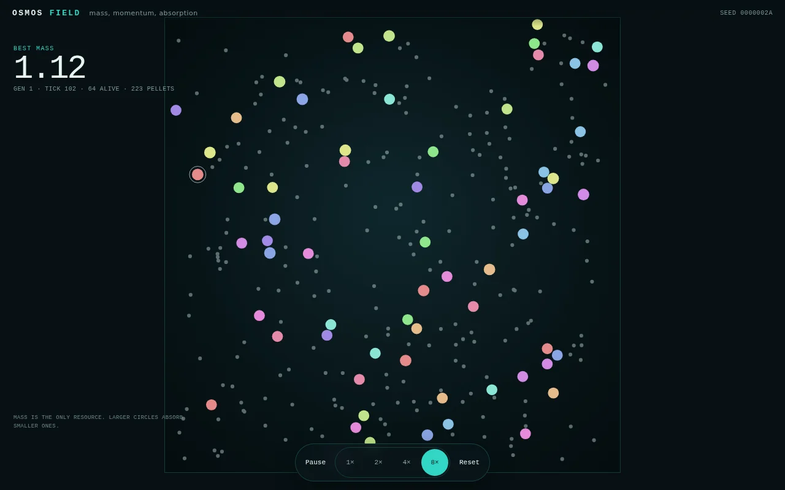
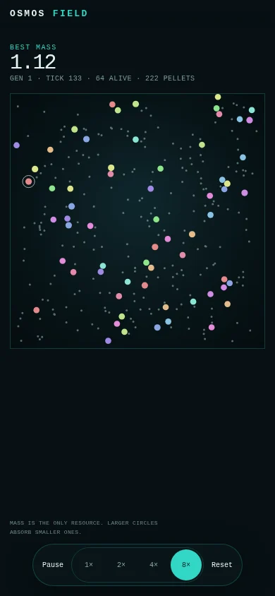

# Phase 2：感知、推进与学习

- 日期：2026-10-22
- 状态：主体完成，native 与 wasm 对齐待补
- 分支：`rewrite/osmos-v2`
- 提交：`b711ee3`、`976597f`，以及本文件所在提交
- 范围：感知、控制网络、质量成本推进、遗传算法、Trainer、headless、Web 世代显示
- 不包含：喷出物实体、猎手、场景、检查面板、Worker

## 1. 结果

Phase 2 让质体有了感知和控制网络。每个 AI 质体有 55 个输入、8 个隐藏神经元和 2 个推进输出。推进消耗质量，质量减少会记录在 `ejected_mass`。遗传算法按质量、存活和目标达成评分。

学习门禁通过。3 个训练种子各跑 60 代，在 10 个留出种子上的中位最终质量都超过随机基线 1.25 倍。最低比值是 1.2502。

Web 端显示 64 个共享世界的质体，HUD 增加世代。60 秒浏览器场景中，1× 约 1.5 代，4× 约 6 代，8× 约 12 代。帧率为 59.83 到 60.00 fps。

## 2. 画面



桌面截图在 8× 运行约 5.2 秒后拍摄。HUD 显示 `GEN 1`、刻度 102、64 个存活质体和 223 个颗粒。



手机截图同样在 `GEN 1`。控件保持 44 px，画布在 HUD 下方。

共享世界用于观看，不用于学习评估。学习评估使用隔离回合，见第 4 节。

## 3. 实现

### 3.1 感知

16 个等角扇区，每个扇区 3 个通道。

- 质量差。正数表示邻居更大，负数表示邻居更小。
- 接近度。越近权重越高。
- 径向速度。正数表示远离，负数表示接近。

自身状态 7 个输入。

- 归一化质量。
- 归一化速度。
- 到四条墙的距离。
- 剩余时间。

总输入为 16 × 3 + 7 = 55。感知范围为 0.25 世界单位。颗粒、同类和猎手都进入感知，喷出物在 Phase 3 加入。

### 3.2 控制网络

拓扑为 55-8-2。隐藏层和输出层使用 `tanh`。基因组长度为 466。

```text
(55 + 1) * 8 + (8 + 1) * 2 = 466
```

基因顺序按层、按神经元，每个神经元先 `bias` 后 `weights`。网络输出二维推进向量，每个分量在 `[-1, 1]`。

### 3.3 推进

推进不生成喷出物实体。它直接扣除质量并改变速度。

- 向量长度大于 0.05 且质量高于 0.05 时推进。
- 本步喷出质量上限为 `max_eject_rate * length / 60`。
- 质量不能低于 0.05。
- 速度变化为 `eject_speed * dm / (mass - dm)`。
- 质量减少记入 `World.ejected_total` 和单质体的 `Mote.ejected_mass`，Phase 2 不回收。

当前参数。

| 参数 | 值 |
| --- | --- |
| 最大速度 | 0.25 |
| 边界恢复系数 | 0.8 |
| 碰撞恢复系数 | 0.8 |
| 吞噬比例 | 2.0 |
| 初始速度 | 0 |
| 最大喷射率 | 0.005 质量/秒 |
| 喷射速度 | 2.0 |

吞噬比例从 1.15 提高到 2.0。Phase 1 的 1.15 会让超过一半质体在一局内被吞并，种群中位质量变成 0，学习信号被死亡噪声覆盖。

### 3.4 遗传算法

- 种群 64。
- 保留 4 个精英。
- 锦标赛规模 3。
- 均匀交叉。
- 每个基因 1% 变异，系数 0.3，结果限制在 `[-3, 3]`。
- 适应度为最终质量加 0.25 存活奖励，再加 0.5 目标奖励。
- 目标质量为 4.0。

### 3.5 训练和显示分离

学习评估使用 `Trainer`。每代使用 2 个固定种子，所有基因组都跑同样的种子。每个基因组在 2 个种子上各跑一局，每局 2,400 步。每局只有 1 个 AI 质体和 236 个颗粒，没有 AI 互相吞噬。这样位置和对手不会主导评分。

Web 使用 `Engine`。64 个基因组共享一个世界，世代结束时选择、交叉、变异并重建世界。这个共享世界用于观看，不用于学习门禁。Web 使用独立的种子常量和独立种群，不加载 Trainer 的基因组。HUD 的世代只证明显示循环在推进，不是学习结论。

隔离回合里单个质体不会被吞并，存活奖励恒为 0.25，目标奖励在 60 代内始终为 0。真正参与选择的是最终质量。后续可以把 Trainer 放进 Worker，让 Web 也用隔离评估。

### 3.6 Headless

新增 `osmos-headless`。

```bash
cargo run --release -p osmos-headless -- --train --generations 60 --seed 42 --holdout 10
```

参数。

- `--train` 使用 `Trainer`。不加时使用共享世界的 `Engine`。
- `--generations` 默认 1。
- `--seed` 默认 42。
- `--motes` 默认 64。
- `--pellets` 默认 236。
- `--episode` 默认 2400。
- `--holdout` 在训练后评估基线种群和最终种群。默认 0。

输出为 JSON Lines，每代一行，最后一行是留出种子结果。

## 4. 学习检查

命令。

```bash
./target/release/osmos-headless --train --generations 60 --seed 42 --holdout 10
./target/release/osmos-headless --train --generations 60 --seed 43 --holdout 10
./target/release/osmos-headless --train --generations 60 --seed 44 --holdout 10
```

留出种子为 1000 到 1009。基线是同一配置下的随机初始种群，最终种群是 60 代后的 64 个基因组。两者都在同样的 10 个种子上各跑一局。先取每个基因组在 10 个种子上的均值，再取 64 个基因组的中位最终质量。

| 训练种子 | 基线中位质量 | 60 代后中位质量 | 比值 |
| --- | --- | --- | --- |
| 42 | 1.7851 | 2.2318 | 1.2502 |
| 43 | 1.7401 | 2.6682 | 1.5334 |
| 44 | 1.7732 | 2.3332 | 1.3158 |

3 个训练种子全部超过 1.25 倍，超过计划的 2/3 门禁。种子 42 的 1.2502 只比阈值高 0.0002，余量很小，结果按实记录。

30 代的数值只是训练集的中位趋势，没有按留出种子做门禁。它显示 30 代不足以形成稳定区分，因此计划把门禁改为 60 代。60 代训练在 2 核机器上约 4 分钟一个种子，含留出复评约 5 分钟。

目标质量 4.0 没有基因组达到，60 代的目标达成率仍接近 0。目标奖励存在，但不是当前学习信号的主要来源。

原始日志在 `docs/phase-2/evidence/train-42.jsonl`、`train-43.jsonl` 和 `train-44.jsonl`。每代的两个训练种子对所有基因组相同。

## 5. 验证

### 5.1 Rust 和构建

```bash
cargo fmt --all -- --check
cargo test --workspace
cargo clippy --workspace --all-targets -- -D warnings
cd osmos-web && npm run check && npm run build
```

结果。

- 格式检查通过。
- Rust 测试 29 个通过。`osmos-core` 5 个，`osmos-evo` 6 个，`osmos-sim` 18 个。
- Clippy 通过，警告为 0。
- TypeScript 和 Oxlint 通过。
- Vite 构建通过。

1,000 步量化哈希在 Phase 2 参数下为 `99b4716d6a4f0026`。Phase 1 的哈希对应旧参数，见 `docs/phase-1.md`。

Headless 500 实体压力测试。

```bash
./target/release/osmos-headless --motes 64 --pellets 436 --generations 1 --seed 42
```

64 个 AI 质体加 436 个颗粒，2,400 步耗时 0.76 到 0.85 秒，约 2,824 到 3,158 步/秒，最大常驻内存约 3.4 到 3.6 MB。计划目标是 2,400 步/秒，已通过。

### 5.2 浏览器

60 秒 Playwright 场景。

| 场景 | FPS | 帧时间 p95 | 世代 | step p95 | snapshot p95 | 长任务 |
| --- | --- | --- | --- | --- | --- | --- |
| 桌面 1× | 59.98 | 16.7 ms | 0 到 1 | 0.7 ms | 0.2 ms | 0 |
| 桌面 4× | 59.93 | 16.7 ms | 0 到 6 | 2.5 ms | 0.2 ms | 0 |
| 桌面 8× | 59.97 | 16.8 ms | 0 到 12 | 4.9 ms | 0.2 ms | 0 |
| 手机 1× | 60.00 | 16.7 ms | 0 到 1 | 0.7 ms | 0.2 ms | 0 |
| 手机 4× | 60.00 | 16.7 ms | 0 到 6 | 2.5 ms | 0.2 ms | 0 |
| 手机 8× | 60.00 | 16.7 ms | 0 到 12 | 4.9 ms | 0.2 ms | 0 |

8× 在 60 秒内完成 12 代，4× 完成 6 代，1× 完成约 1.5 代。最大帧时间为 17.4 ms，长任务为 0。8× 下每帧 `step` 加 `snapshot` 的 p95 约为 5.1 ms，低于 8 ms 的 Worker 触发线。当前不使用 Worker。

起始和结束的 `bestMass` 在 `ui-verify.jsonl` 中记录。世代重置时 HUD 的最佳质量会归零，因此它只用于页面证据，不是学习曲线。所有按钮边界检查没有小于 44 px 的项。页面错误为 0。

原始结果在 `docs/phase-2/evidence/ui-verify.jsonl`。交互结果在 `docs/phase-2/evidence/interactions.jsonl`。

### 5.3 产物大小

| 文件 | 原始大小 | gzip |
| --- | --- | --- |
| wasm | 97.78 KB | 42.27 KB |
| JavaScript | 22.71 KB | 9.24 KB |
| CSS | 3.64 KB | 1.30 KB |

wasm 仍低于 120 KB 的 gzip 预算，静态资源总量低于 200 KB。

## 6. 偏差和决策

| 决策 | 计划 | 实际 | 原因 |
| --- | --- | --- | --- |
| 隐藏层 | 24 | 8 | 1,394 个基因在 30 到 100 代内没有稳定提升；466 个基因可以学习 |
| 学习代数 | 30 | 60 | 30 代的训练中位不足以稳定区分，60 代留出检查 3 个种子全部通过 |
| 评估方式 | 64 个共享一局 | 每个基因组 2 个隔离回合 | 共享世界的死亡和位置噪声压过觅食能力 |
| 喷出物 | Phase 2 | Phase 3 | 先验证学习，再加入实体和再吸收 |
| 吞噬比例 | 1.15 | 2.0 | 减少早期被吞并，保留中位质量信号 |
| 初始速度 | 随机漂移 | 0 | 让推进成为主要运动来源 |
| 推进参数 | 0.05 每秒，0.18 速度 | 0.005 每秒，2.0 速度 | 保持质量成本可见，同时让转向有效 |
| Web 训练 | 同一世界 | 共享世界显示，隔离回合训练 | 避免世代切换长时间阻塞 |

## 7. 已知差距

- 没有喷出物实体，喷射质量直接离开世界，质量不守恒。`World.ejected_total` 记录累计喷射质量，Phase 3 加入喷出物和再吸收。
- 没有猎手、猎物和场景。Phase 3 加入。
- Web 的共享世界没有经过学习门禁。它只负责显示；Trainer 才是训练路径。
- Web 世代切换在主线程执行，当前选择、交叉和重建很快，但没有 Worker。Phase 5 视需要加入。
- 手机帧率是桌面 Chrome 的手机视口，不是真机。Phase 5 用真机或云真机验证。
- 目标质量 4.0 没有达到。Phase 3 增加颗粒补充和生态后重新评估目标。
- native 与 wasm 的 1,000 步对齐没有完成，wasm 10 代趋势也没有单独记录。这两项仍是 Phase 2 的剩余验证。

## 8. 下一步

Phase 3 做三件事。

1. 加入喷出物实体、再吸收、到期转颗粒和质量上限。
2. 加入猎手、猎物、平静和捕食场景。
3. 重新跑学习检查，确认加入喷出物后仍然通过。

Phase 3 不加入检查面板和完整移动端体验。这些属于 Phase 4。
