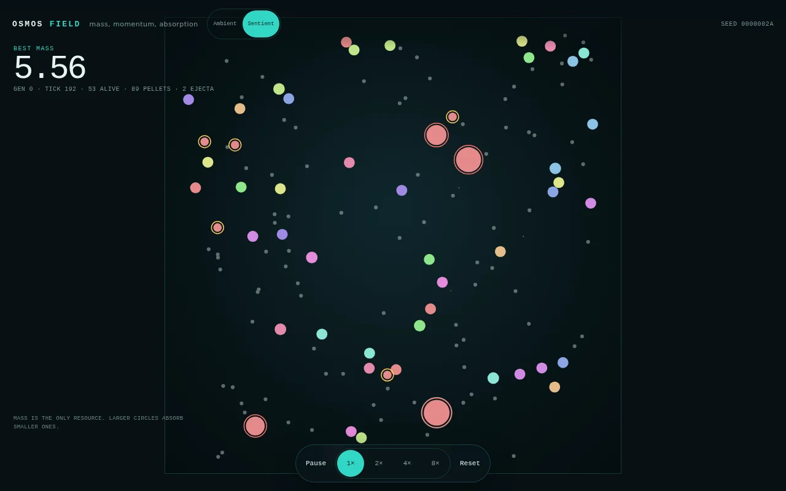
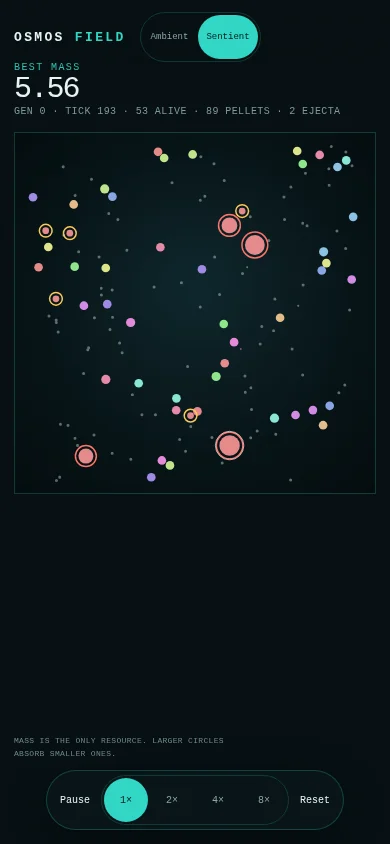

# Phase 3：喷出物、猎手与场景

- 日期：2026-10-22
- 状态：主体完成，学习门禁 2/3 通过
- 分支：`rewrite/osmos-v2`
- 提交：`1f8eda3`，以及本文件所在提交
- 范围：喷出物、再吸收、质量账本、猎手、猎物、平静和捕食场景
- 不包含：检查面板、世代图表、Worker、真机验证

## 1. 结果

Phase 3 加入喷出物实体、猎手、猎物和两个场景。Web 可以在 Ambient 和 Sentient 之间切换，并绘制喷出物。

学习门禁通过 2/3。种子 42 和 43 在 10 个留出种子上超过 1.25 倍，种子 44 失败，比值 1.0532。计划要求 3 个训练种子中至少 2 个通过，因此门禁通过，但稳定性不足。

## 2. 画面



桌面截图在 `seed=42`、Sentient、运行约 2.6 秒后拍摄。HUD 显示 `GEN 0`、刻度 192、53 个存活、89 个颗粒和 2 个喷出物。红色外环是猎手，黄色外环是猎物。



手机截图同样显示 Sentient。场景切换按钮在顶栏，控件保持 44 px。

## 3. 喷出物

### 3.1 生成

推进时质量先进入质体的 `pending_ejecta`。每累计 0.01 质量生成一个喷出物实体。

- 喷出物质量 0.01。
- 初始位置在质体后方。
- 速度等于质体速度减去推进方向乘以喷射速度。
- 母体在 18 个刻度内不能吸收自己的喷出物。

### 3.2 生命周期

- 每个外步增加 `age`。
- 存活 480 个刻度，约 8 秒。
- 到期后转为颗粒。
- 颗粒达到上限时，质量并入最近的颗粒。
- 最多 512 个喷出物，超过时最早的转为颗粒。

### 3.3 再吸收和质量账本

任何质体在免疫期后可以吸收喷出物。吸收时质量和动量一起转移。

`World.ejected_total` 记录累计喷射质量。`World.total_mass` 包含存活质体、待生成喷出物、存活颗粒和存活喷出物。新增测试检查喷射前后总质量守恒。

Phase 2 的 `ejected_mass` 只统计存活质体，会漏掉被吞并质体的喷射质量。这个缺口已由 `ejected_total` 补上。

## 4. 猎手、猎物和场景

### 4.1 场景

| 场景 | AI | 颗粒 | 猎手 | 猎物 |
| --- | --- | --- | --- | --- |
| Ambient | 64 | 236 | 0 | 0 |
| Sentient | 48 | 100 | 4 | 12 |

Ambient 保持 300 个实体的初始密度。Sentient 是 48 个 AI、4 个猎手和 12 个猎物。

### 4.2 猎手

猎手质量为 2.0，最大速度为 0.11。它们追逐最近的猎物，不主动追逐 AI。

猎手会吞并碰撞到的较小质体，包括 AI。AI 长到 4.0 以上时可以反吞猎手。猎手不消耗质量推进，速度由脚本设置。

### 4.3 猎物

猎物质量为 0.6，随机漂移，不进化。AI 和猎手都可以吞并猎物。

### 4.4 场景切换

Web 顶栏有 Ambient 和 Sentient 两个按钮。切换场景会重建世界，保留当前种子，重置世代和统计。场景写入 URL 的 `scenario` 参数。

`osmos-headless` 的共享世界默认使用 Ambient。`--train` 始终使用隔离的 Ambient 回合。

## 5. 学习检查

命令。

```bash
./target/release/osmos-headless --train --generations 60 --seed 42 --holdout 10
./target/release/osmos-headless --train --generations 60 --seed 43 --holdout 10
./target/release/osmos-headless --train --generations 60 --seed 44 --holdout 10
```

训练使用 2 个公共种子，每个基因组每代各跑一局。留出种子为 1000 到 1009。每个基因组跑 10 个留出种子，先取均值，再取 64 个基因组的中位最终质量。

| 训练种子 | 基线中位质量 | 60 代后中位质量 | 比值 | 门禁 |
| --- | --- | --- | --- | --- |
| 42 | 1.7878 | 2.2961 | 1.2843 | 通过 |
| 43 | 1.7401 | 2.7124 | 1.5588 | 通过 |
| 44 | 1.7885 | 1.8836 | 1.0532 | 失败 |

2/3 通过。种子 44 说明喷出物加入后学习不稳定。Phase 4 不应把 2/3 当作稳定收敛。

原始日志在 `docs/phase-3/evidence/train-42.jsonl`、`train-43.jsonl` 和 `train-44.jsonl`。

## 6. 验证

### 6.1 Rust 和构建

```bash
cargo fmt --all -- --check
cargo test --workspace
cargo clippy --workspace --all-targets -- -D warnings
cd osmos-web && npm run check && npm run build
```

结果。

- 格式检查通过。
- Rust 测试 32 个通过。`osmos-core` 5 个，`osmos-evo` 8 个，`osmos-sim` 19 个。
- Clippy 通过，警告为 0。
- TypeScript 和 Oxlint 通过。
- Vite 构建通过。

1,000 步量化哈希仍为 `99b4716d6a4f0026`。喷出物不进入快照哈希的质子和颗粒字段。

### 6.2 浏览器

60 秒 Playwright 场景，6 个组合。

| 场景 | FPS | 帧时间 p95 | 世代 | step p95 | snapshot p95 | 长任务 |
| --- | --- | --- | --- | --- | --- | --- |
| 桌面 1× | 59.97 | 16.7 ms | 0 到 1 | 0.7 ms | 0.2 ms | 0 |
| 桌面 4× | 59.88 | 16.7 ms | 0 到 6 | 2.7 ms | 0.2 ms | 0 |
| 桌面 8× | 59.88 | 16.8 ms | 0 到 12 | 5.3 ms | 0.2 ms | 0 |
| 手机 1× | 60.00 | 16.7 ms | 0 到 1 | 0.8 ms | 0.2 ms | 0 |
| 手机 4× | 60.00 | 16.7 ms | 0 到 6 | 2.7 ms | 0.2 ms | 0 |
| 手机 8× | 59.98 | 16.7 ms | 0 到 12 | 5.4 ms | 0.2 ms | 0 |

8× 下 `step` 加 `snapshot` 的 p95 约为 5.5 ms，低于 8 ms 的 Worker 触发线。最大帧时间 22.5 ms，长任务为 0。所有按钮达到 44 px，页面错误为 0。

原始结果在 `docs/phase-3/evidence/ui-verify.jsonl`。

### 6.3 产物大小

| 文件 | 原始大小 | gzip |
| --- | --- | --- |
| wasm | 107.08 KB | 45.35 KB |
| JavaScript | 23.62 KB | 9.52 KB |
| CSS | 4.01 KB | 1.33 KB |

wasm 仍低于 120 KB 的 gzip 预算。

## 7. 偏差和已知差距

- 猎手只主动追逐猎物，不主动追逐 AI。原始计划让猎手追逐较小质体，包括 AI。当前选择让 Sentient 在初始世代仍能看到 AI 存活。
- 猎手数量从 8 降到 4，质量从 3.0 降到 2.0，速度从 0.18 降到 0.11。原因是初始版本在约 13 秒内清空全部 AI。
- 学习门禁只有 2/3，通过但不稳定。种子 44 失败。
- 目标质量 4.0 仍未达到。喷射成本、颗粒密度和猎手压力需要继续平衡。
- 没有检查面板、世代图表、暂停时检查、Worker 和真机数据。这些属于 Phase 4 和 Phase 5。
- native 与 wasm 的 1,000 步对齐仍未完成。

## 8. 下一步

Phase 4 做检查面板和完整交互。

1. 点击质体，显示质量、角色、感知、推进输出、吸收计数和喷射质量。
2. 桌面右侧面板，手机底部面板。
3. 暂停时显示完整感知扇区和推进箭头。
4. 世代统计和场景说明进入界面。
5. 键盘操作和减少动态继续验证。

Phase 4 不改变学习算法。Phase 5 再做性能、内存和真机加固。
