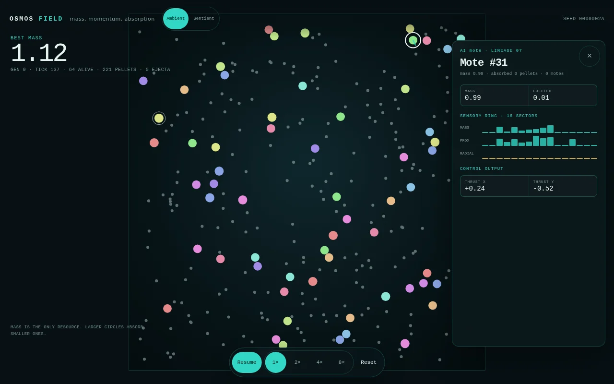
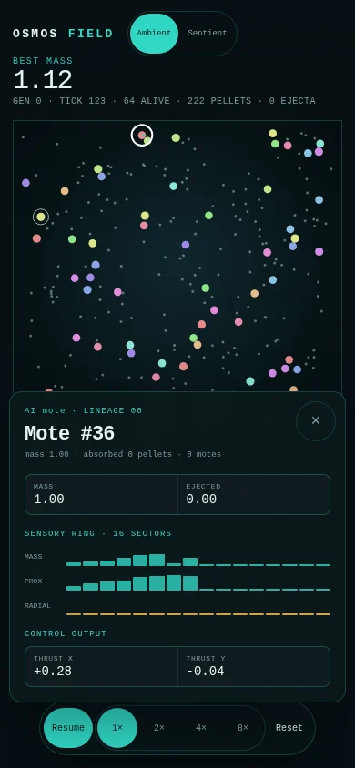

# Phase 4：检查面板与交互

- 日期：2026-10-22
- 状态：核心完成，世代图表和种子输入未做
- 分支：`rewrite/osmos-v2`
- 提交：`1f8eda3`、`cd465a3`，以及本文件所在提交
- 范围：质体选择、检查面板、感知条、控制输出、场景切换、键盘
- 不包含：世代图表、种子文本输入、Worker、真机验证

## 1. 结果

Phase 4 加入质体选择。点击或轻触质体，桌面右侧出现检查面板，手机底部出现检查面板。面板显示质量、角色、吸收计数、累计喷射质量、16 扇区感知、推进输出和白色选中环。

场景切换在顶栏。Ambient 和 Sentient 都可以直接进入。键盘支持空格暂停、方向键调速、`R` 重置和 `Esc` 关闭面板。

## 2. 画面



桌面截图选中 Mote #31，质量 0.99，EJECTED 0.01。右侧面板显示三组 16 扇区感知条和推进输出。选中质体有白色外环和青色推进线。



手机截图选中 Mote #36，质量 1.00。检查面板从底部出现，最大高度 52 dvh，关闭按钮在右上角。

## 3. 交互

### 3.1 选择

画布点击坐标映射回世界坐标。渲染器按快照半径做命中测试，选择最近的质体。点击空白区域关闭面板。

选中只影响显示。它不暂停世界，也不改变仿真状态。

### 3.2 检查面板

面板读取 `Engine.inspect(id)`，每 250 ms 更新一次。

- 质量。
- 角色和谱系。
- 吸收的颗粒数和质体数。
- 累计喷射质量。
- 16 扇区质量差、接近度和径向速度。
- 二维推进输出。

感知条使用绝对值作为高度。质量差和径向速度的正负由原始数据保留，但视觉上不区分正负。后续可以加入中心线。

### 3.3 键盘

- 空格暂停或恢复。
- 上箭头和下箭头把速度加倍或减半。
- `R` 重置世界。
- `Esc` 关闭检查面板。

## 4. 验证

### 4.1 构建和测试

```bash
cargo fmt --all -- --check
cargo test --workspace
cargo clippy --workspace --all-targets -- -D warnings
cd osmos-web && npm run check && npm run build
```

结果。

- 32 个 Rust 测试通过。`osmos-core` 5 个，`osmos-evo` 8 个，`osmos-sim` 19 个。
- Clippy 警告为 0。
- TypeScript 和 Oxlint 通过。
- Vite 构建通过。

### 4.2 真实页面

Playwright 检查以下流程。

- 打开 `seed=42`。
- 暂停世界。
- 扫描画布并选中一个质体。
- 确认检查面板出现，标题包含 `Mote #`。
- 确认面板包含质量、喷射质量、感知条和推进输出。
- 确认关闭按钮隐藏面板。
- 空格暂停和恢复。
- `Esc` 关闭面板。
- Ambient 和 Sentient 切换后世界重建。

桌面和手机视口都通过。截图在 `docs/phase-4/`。

### 4.3 性能

Phase 3 的 60 秒 6 场景结果仍然适用。未选中质体时，每帧只多一次 `selectedId` 比较。选中时，每 250 ms 读取一次检查数据，并绘制 48 个感知条。

8× 下 `step` 加 `snapshot` 的 p95 约为 5.5 ms，长任务为 0。检查面板没有引入新的每帧 wasm 调用。

### 4.4 产物大小

| 文件 | 原始大小 | gzip |
| --- | --- | --- |
| wasm | 108.36 KB | 45.74 KB |
| JavaScript | 27.25 KB | 10.69 KB |
| CSS | 6.11 KB | 1.76 KB |

静态资源仍在预算内。

## 5. 偏差和已知差距

- 没有世代图表。`bestMass` 和世代只在 HUD 显示。
- 没有种子文本输入。种子通过 Reset 和 URL 参数管理。
- 没有 `I` 快捷键选中质体。选择靠点击或轻触。
- 感知条不区分正负，只显示幅度。
- 检查面板没有显示控制网络的隐藏层激活。
- 手机数据来自桌面 Chrome 的手机视口。
- 没有真机、Firefox 或 Safari 结果。

## 6. 下一步

Phase 5 做加固。

1. 10 分钟连续运行和内存记录。
2. 500 实体压力测试和 wasm 体积复核。
3. Chrome、Firefox、Safari 检查。
4. CI 在 GitHub 上运行。
5. 部署预览和回滚脚本。

Phase 6 是生产切换。生产切换前需要单独确认。
